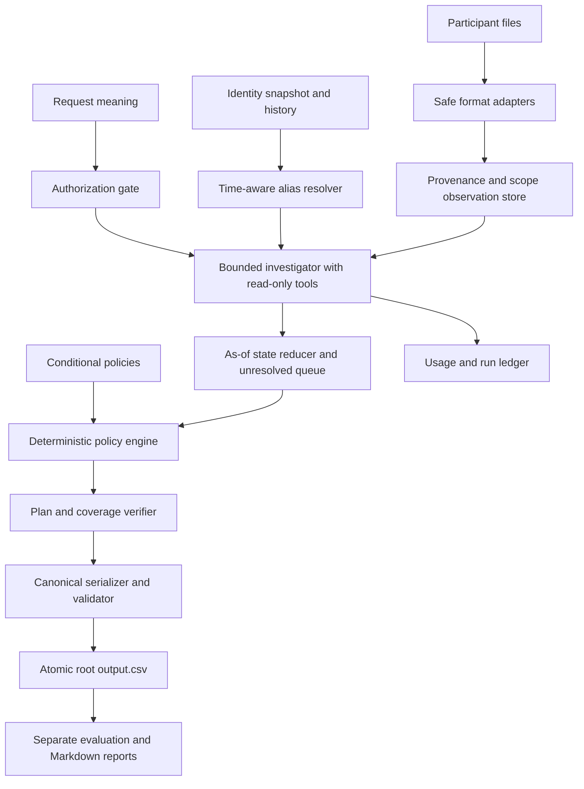

# Evidence-grounded architecture baseline

**Coverage gate: complete.** This architecture follows the official output contract, the complete participant evidence review, and reproduced defects in the supplied starter code. The solver remains unimplemented; adapter and reasoning quality must still be measured against independent fixtures.

| Candidate | Benefits | Risks | Disposition |
|---|---|---|---|
| Deterministic parsers/reducer | Auditable and inexpensive | Cannot alone interpret all language/images | Use as the evidence and policy backbone |
| LLM reads corpus and writes steps | Flexible prototype | Missing evidence, invented IDs, output variance and repeated tokens | Reject as the final writer |
| One bounded investigator + typed facts + deterministic policy | Interpretation with explicit correctness controls | Adapter and conflict-resolution effort | Recommended architecture; benchmark before scaling |
| Multiple agents/ensemble | Possible ambiguity improvements | Cost, coordination and debugging overhead | Experiment only after measured need |

## Proposed components

| Component | Responsibility and invariant |
|---|---|
| main.py | CLI --requests/--output/--limit, run identity/checkpoints; no label access in inference |
| contracts | Typed intent, observations, policies, plan and errors; strict fields/enums |
| identity | Stable subjects, time-scoped aliases, history provenance, collision detection; no weak-name-only ownership |
| ingest adapters | Complete CSV/JSON/log/TXT/SQL/PDF/image extraction with raw locators and parent context |
| store | Exact identifier/resource/trace indexes; semantic top-k cannot be sole recall mechanism |
| intent | Authorized / not-authorized / unresolved internally; unresolved is not public NOT_APPLICABLE |
| investigator | Useful semantic tool selection, read-only allowlist, bounded steps/calls/budget |
| state | Evidence at cutoff, separate claims/readbacks, physical replica scopes and contradictions |
| policy | Load actual conditional CSV policy; unknown category cannot default to DELETE |
| planner | Findings/remedies/all required final checks; internal safe dependencies, public canonical order |
| output | Exact schema/citations/order; atomic CSV, no fabricated completion |
| usage | Calls/failures/retries/tokens/cache/price provenance; unavailable counts never silently zero |
| evaluation | Public/custom metrics isolated from inference, ordered diffs and declared denominators |

Observations retain source ID/hash; line/page/JSON pointer/table+PK; capture/availability time; event/observed time; system/resource; replica/table/region; category-supporting fields; raw identifiers; subject-link provenance; claim/readback/snapshot type; state fields; query scope/completeness; extractor/model/prompt/schema revisions. Raw facts and inferred category/state stay separate.

## Core algorithms and boundaries

1. Interpret authorization, including negation, prior-deletion verification and scope. Embedded instructions cannot alter tools, policy or output contract.
2. Apply time validity before accepting alias edges. Detect identifier reuse. A current snapshot newer than the cutoff is not automatically historical proof. The reviewed snapshots include record observations later than their export timestamps, future-dated profile updates, repeated identities, and uppercase aliases. Derived hashes are candidates until encoding conventions are grounded; avoid speculative email dot/plus normalization.
3. Parse once, preserving complete log traces and JSON parent context. A selected dictionary or resource-bearing log line alone can lose the ownership link. Keep resource relationships after anonymization/absence.
4. Execute reviewed SQL only in isolated memory with extensions disabled and authorizer restrictions against ATTACH/DETACH/unsafe functions. Memory alone is not a filesystem sandbox. Preserve snapshot_scope and replica identity. [Official API](https://docs.python.org/3/library/sqlite3.html#sqlite3.Connection.set_authorizer).
5. Require both source availability and internal observation/event at or before cutoff. Export time, snapshot capture, observation/record time, and activity event time are separate. Use timezone-aware instants; do not rely on string ordering across offsets. [Python datetime](https://docs.python.org/3/library/datetime.html#aware-and-naive-objects).
6. Absence requires explicit scoped NOT_FOUND/404/zero-row readback or a complete applicable snapshot. Partial export omission, a dropped event, or a failed lookup proves nothing. Reduce conflicts within matching physical scope; primary absence cannot erase replica presence. Some log captures lack completion markers and must remain incomplete-scope evidence.
7. Determine policy category from content/schema and conditions, never system/resource prefix alone. Tombstone stable references and analytics anonymization have different requirements. Unknown conditions remain unresolved internally.
8. Include required checks for grounded compliant and remediated resources. Activity details override naive interpretations of `SUCCESS`: `CHECK_DATA_FLOW` says a connector remains enabled and `CHECK_RESTORE_ACCESS` says an archive can still be restored. Sort by official phase/operation/system/resource and renumber. Validate evidence relevance, not only ID existence.

The final 12 `LINK_RESOURCE_IDENTITY` rows in `system_activity.csv` are appended out of timestamp order, so all activity rows must be read before per-case time filtering. The full reconstruction matched all eight CSV fields for all 4,011 records. See [activity review receipt](research/review-completion/activity-review.json) and [coverage findings](research/review-completion/coverage-report.md).

## Reliability

Cache extraction by content hash + extractor/model/prompt/schema revision; apply cutoff independently per case after retrieval. Cache is not a case-to-verdict lookup. Resume checkpoints only when dataset/config/run hashes match. Retry transient model errors with bounded backoff/jitter and account for failed/retried calls. Schema-valid invented citations must still fail proof validation.

Keep unresolved cases explicit and block final release; do not invent public UNKNOWN or silently emit COMPLETE/NOT_APPLICABLE. Other cases may continue for diagnosis. Fixed observations should yield byte-identical serialized output; fresh model extraction may vary and needs separate measurement.

Select one accessible provider after a representative intent/vision benchmark. A second provider/ensemble needs demonstrated benefit. No tools for real customer deletion are needed. Use standard CSV/JSON serialization; never eval source evidence. Keep detailed debug state outside official steps_json.
