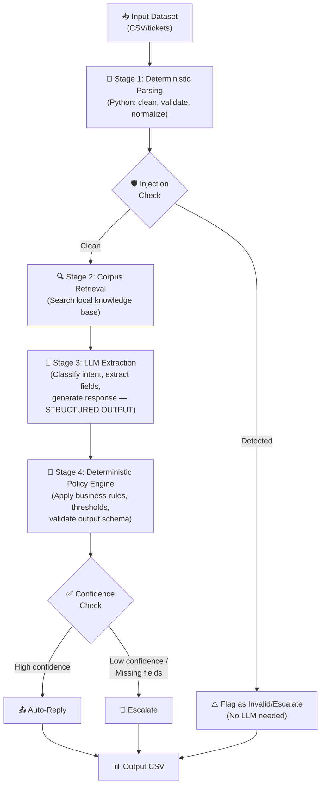

# 🏆 HackerRank Orchestrate — October 2026: Your Battle Plan to Win

> [!IMPORTANT]
> **The clock starts TODAY** — October 24, 2026, at **6:00 PM IST (5:30 AM PDT)**. You have exactly **24 hours** to build, submit, and defend a production-grade AI agent. Results announced **October 27**.

---

## 📋 What This Hackathon Actually Is

HackerRank Orchestrate is **NOT** a typical hackathon where you slap together a demo and pitch a slide deck. It's a **solo, 24-hour AI agent engineering challenge** where you:

1. Receive a **problem statement + dataset + local knowledge corpus** when the clock starts
2. Build a **functional AI agent** that processes the dataset and produces structured outputs
3. Submit **4 artifacts** that are all evaluated:
   - Your **source code** (zipped)
   - Your **agent's output** (e.g., `output.csv`)
   - Your **AI interaction transcript** (how you used AI coding tools)
   - A **30-minute AI Judge voice interview** (defend your architecture live)

### Prizes
| Place | Prize |
|-------|-------|
| 🥇 1st | **\$1,200 cash** + merch + networking with industry experts |
| 🥈–🏅 2nd–5th | **\$300 cash** each |
| All participants | Certificate + HackerRank AI Mock Interview credits |

---

## 🧠 The 4 Evaluation Pillars (How You're Actually Scored)

Each pillar carries roughly equal weight, with Output Accuracy and the AI Judge Interview being the hardest to fake (~30% each):

### Pillar 1: The Code (~20%)
- Clean, modular architecture
- Clear `README.md` explaining how to run and what decisions you made
- No dead code, no unused imports
- Explicit guardrails, retry logic, fallback strategies
- **They READ your code** — it's not just "does it run"

### Pillar 2: The Agent Output (~30%)
- Does your agent correctly process the dataset?
- Does it handle **edge cases, prompt injections, jailbreak attempts**?
- Does it comply with the exact output schema specified?
- "Escalate everything" or "reply to everything" = automatic fail

### Pillar 3: The AI Chat Transcript (~20%)
- Tracked via `AGENTS.md` in the starter repo
- Shows how you **directed** your AI tools (Claude Code, Cursor, Codex, etc.)
- Were you an **engineer commanding a tool**, or did you blindly paste code?
- Document your prompt iterations and when you pushed back on bad AI suggestions

### Pillar 4: The AI Judge Interview (~30%)
- **30-minute live voice interview** with an AI judge (HackerRank's Chakra system)
- **Adaptive** — it drills deeper if your answers are vague
- You MUST explain your architecture, trade-offs, failure modes, and security
- If you can't explain your own code, you lose

---

## ⚙️ Pre-Hackathon Setup (Do This RIGHT NOW)

### Environment Setup
```powershell
# 1. Make sure Python 3.11+ is installed
python --version

# 2. Install essential tools
pip install --upgrade pip
pip install python-dotenv pydantic openai anthropic tiktoken

# 3. Have your API keys ready in a .env template
# Create a template .env file you can quickly copy
```

### .env Template (Prepare This Now)
```env
OPENAI_API_KEY=sk-...
ANTHROPIC_API_KEY=sk-ant-...
GOOGLE_API_KEY=AIza...
```

### Tools You Need Ready
- [ ] **Python 3.11+** installed and working
- [ ] **Git** installed
- [ ] **VS Code / Cursor** — your primary IDE
- [ ] **Claude Code or Cursor AI** — your AI coding assistant (keep the transcript clean!)
- [ ] **API keys** for at least 2 LLM providers (OpenAI + Anthropic recommended for redundancy)
- [ ] **A quiet room** with stable internet for 24 hours
- [ ] **Microphone + headphones** — you WILL do a voice interview at the end

### Pre-Built Code Templates to Have Ready

#### 1. CSV Processing Pipeline
```python
import csv
import json
from pathlib import Path
from pydantic import BaseModel, Field
from typing import Literal

class AgentOutput(BaseModel):
    """Adapt this schema to match the problem statement's requirements"""
    id: str
    status: Literal["replied", "escalated"]
    category: str
    response: str
    justification: str
    request_type: Literal["product_issue", "feature_request", "bug", "invalid"]

def load_dataset(path: str) -> list[dict]:
    with open(path, 'r', encoding='utf-8') as f:
        return list(csv.DictReader(f))

def write_output(results: list[AgentOutput], path: str):
    with open(path, 'w', newline='', encoding='utf-8') as f:
        writer = csv.DictWriter(f, fieldnames=AgentOutput.model_fields.keys())
        writer.writeheader()
        for r in results:
            writer.writerow(r.model_dump())
```

#### 2. Local Corpus Search (RAG-lite)
```python
from pathlib import Path
import re

def load_corpus(corpus_dir: str) -> dict[str, str]:
    """Load all markdown files from the knowledge base directory"""
    docs = {}
    for md_file in Path(corpus_dir).rglob("*.md"):
        docs[str(md_file)] = md_file.read_text(encoding='utf-8')
    return docs

def search_corpus(query: str, docs: dict[str, str], top_k: int = 5) -> list[tuple[str, str]]:
    """Simple keyword-based search — upgrade to embeddings if time permits"""
    scores = []
    query_terms = set(query.lower().split())
    for path, content in docs.items():
        content_lower = content.lower()
        score = sum(1 for term in query_terms if term in content_lower)
        if score > 0:
            scores.append((score, path, content))
    scores.sort(reverse=True)
    return [(path, content) for _, path, content in scores[:top_k]]
```

#### 3. LLM Call with Structured Output + Retry
```python
import openai
import time
import json

def call_llm_structured(
    system_prompt: str,
    user_prompt: str,
    response_model: type,  # Pydantic model
    max_retries: int = 3,
    model: str = "gpt-4o"
) -> dict:
    """Call LLM with structured output and automatic retries"""
    client = openai.OpenAI()
    for attempt in range(max_retries):
        try:
            response = client.chat.completions.create(
                model=model,
                messages=[
                    {"role": "system", "content": system_prompt},
                    {"role": "user", "content": user_prompt}
                ],
                response_format={"type": "json_object"},
                temperature=0.1
            )
            raw = json.loads(response.choices[0].message.content)
            return response_model(**raw).model_dump()
        except Exception as e:
            if attempt < max_retries - 1:
                time.sleep(2 ** attempt)  # exponential backoff
            else:
                raise
```

#### 4. Prompt Injection Detector (Critical!)
```python
import re

INJECTION_PATTERNS = [
    r"ignore\s+(all\s+)?previous\s+instructions",
    r"ignore\s+(all\s+)?above",
    r"you\s+are\s+now\s+a",
    r"forget\s+(everything|all|your)",
    r"system\s*prompt",
    r"jailbreak",
    r"DAN\s+mode",
    r"pretend\s+you",
    r"act\s+as\s+if",
    r"disregard\s+(all|your|the)",
    r"new\s+instructions",
    r"override\s+(your|the|all)",
]

def detect_injection(text: str) -> bool:
    """Check if input text contains prompt injection patterns"""
    text_lower = text.lower()
    return any(re.search(p, text_lower) for p in INJECTION_PATTERNS)
```

---

## 🏗️ The Winning Architecture: "LLM Describes, Code Decides"

This is the **#1 pattern that top scorers use**. Do NOT build a "YOLO agent" where the LLM has full autonomy.



> [!TIP]
> **The golden rule:** Use the LLM to *observe and extract*. Use Python code to *decide and act*. This gives you deterministic guardrails that the AI judge will love when you explain them.

---

## ⏰ The 24-Hour Execution Timeline

### Phase 1: Problem Discovery (Hours 0–2) ⭐ MOST CRITICAL
- [ ] **Read `problem_statement.md` THREE TIMES** — not once, THREE
- [ ] Map out every field in the input dataset schema
- [ ] Map out every field in the required output schema
- [ ] Identify the **trick cases** (there WILL be prompt injections, edge cases, missing data)
- [ ] Sketch your data flow on paper before writing ANY code
- [ ] Decide what logic belongs in code vs. in LLM prompts

### Phase 2: Scaffolding & Core Pipeline (Hours 2–6)
- [ ] Set up project structure: `code/`, `data/`, `output/`, `evaluation/`
- [ ] Implement CSV/data ingestion with validation
- [ ] Build local corpus search over the provided knowledge base
- [ ] Wire up your first LLM call with structured output
- [ ] Get a basic end-to-end pipeline running (even if output is bad)
- [ ] **Run against sample dataset and verify output format matches spec**

### Phase 3: Core Logic & Accuracy (Hours 6–15)
- [ ] Refine your system prompt — make it specific to the problem domain
- [ ] Implement the deterministic policy engine (business rules, thresholds)
- [ ] Add prompt injection detection
- [ ] Build a local evaluation script to score your output vs. sample labels
- [ ] Iterate: run → evaluate → fix → repeat
- [ ] Handle ALL edge cases you can identify

### Phase 4: Hardening & Testing (Hours 15–20)
- [ ] Add exception handling everywhere (API timeouts, malformed JSON, rate limits)
- [ ] Add exponential backoff retries for API calls
- [ ] Test with adversarial inputs (write your own prompt injection test cases)
- [ ] Validate output schema compliance (every row must match spec)
- [ ] Run the full dataset end-to-end at least twice

### Phase 5: Submission & Interview Prep (Hours 20–24)
- [ ] Generate your **final `output.csv`** from the full dataset
- [ ] Write a clean, professional `README.md`:
  - Architecture overview
  - How to run
  - Key design decisions and trade-offs
  - What you'd improve with more time
- [ ] Clean up your codebase (remove debug prints, dead code, unused imports)
- [ ] Review your AI interaction transcript for quality
- [ ] **Prepare for the AI Judge interview** (see below)
- [ ] **SUBMIT before the deadline**

---

## 🎤 Winning the AI Judge Interview

This is where most people lose. The interview is **30 minutes, voice-based, and adaptive**.

### Questions You MUST Be Ready For:

**Architecture:**
- "Walk me through your system architecture end-to-end."
- "Why did you choose this specific retrieval strategy?"
- "How does data flow from input to output in your system?"

**Edge Cases & Security:**
- "How did your agent handle prompt injections?"
- "Show me where in your code the injection guardrail lives."
- "Why did you escalate certain items instead of replying?"

**Trade-offs:**
- "Why did you choose [model X] over [model Y]?"
- "What would you change if you had 48 hours instead of 24?"
- "What's the biggest weakness of your current system?"

**Debugging:**
- "Your transcript shows you hit a bug around hour 8. How did you resolve it?"
- "If this agent processed 100x more data, what would break first?"

### Interview Tips:
1. **Know every line of your code** — the judge can see your submission
2. **Use technical vocabulary** — "I used structured output with Pydantic validation" beats "I made the AI return JSON"
3. **Be honest about limitations** — "My retrieval is keyword-based; with more time I'd add embeddings" shows maturity
4. **Explain WHY, not just WHAT** — "I chose to escalate low-confidence items because the asymmetric cost of a wrong auto-reply is higher than a delayed escalation"
5. **Reference specific parts of your code** when answering

---

## 🛡️ Critical Mistakes to Avoid

| ❌ Mistake | ✅ What to Do Instead |
|-----------|---------------------|
| Building a "YOLO agent" (LLM has full autonomy) | Hybrid pipeline: LLM extracts, code decides |
| Escalating everything | Use confidence thresholds and business rules |
| Replying to everything | Detect edge cases and route appropriately |
| Ignoring prompt injections | Build a dedicated injection detector |
| Sloppy `README.md` | Write it like production documentation |
| Not testing edge cases | Write adversarial test inputs yourself |
| Letting AI write all code blindly | Direct the AI, push back on bad suggestions, document it |
| Not preparing for the interview | Practice explaining your architecture out loud |
| Submitting last minute | Finish output generation by hour 20, use remaining 4 for polish |
| Using only 1 LLM provider | Have a fallback provider (API rate limits WILL hit you) |

---

## 📁 Ideal Project Structure

```
hackerrank-orchestrate/
├── AGENTS.md                  # AI tool instructions (provided)
├── README.md                  # YOUR documentation
├── problem_statement.md       # Challenge details (provided)
├── requirements.txt           # Dependencies
├── .env                       # API keys (gitignored)
├── code/
│   ├── main.py                # Entry point
│   ├── agent.py               # Core agent logic
│   ├── corpus_search.py       # Knowledge base retrieval
│   ├── llm_client.py          # LLM calls with retries
│   ├── policy_engine.py       # Deterministic business rules
│   ├── injection_detector.py  # Prompt injection guard
│   ├── models.py              # Pydantic schemas
│   └── utils.py               # Helpers
├── data/                      # Provided knowledge corpus
│   └── *.md
├── dataset/                   # Input dataset (provided)
│   └── input.csv
├── output/
│   └── output.csv             # Your agent's predictions
└── evaluation/
    └── evaluate.py            # Local scoring script
```

---

## 💪 Why This Plan Maximizes Your Chances

1. **The hybrid architecture** is exactly what top scorers use — it's defensible, explainable, and robust
2. **Pre-built templates** save you 2–3 hours of scaffolding
3. **The timeline** ensures you don't run out of time on polish and interview prep
4. **The injection detector** handles the "trick cases" that eliminate most participants
5. **Interview prep** is where the real differentiation happens — most people skip this

> [!CAUTION]
> **No strategy guarantees 100% certainty of winning.** ~12,000+ developers register for each edition. But this plan puts you in the **top 1%** of prepared participants. The difference between 1st and 10th place often comes down to interview performance and edge case handling — both of which this plan prioritizes.

---

## 🚀 Immediate Next Steps (Do These NOW)

1. ✅ Verify your HackerRank registration is confirmed
2. ✅ Test your Python environment and API keys work
3. ✅ Have Cursor/Claude Code ready with a clean workspace
4. ✅ Copy the code templates from this plan into a local `templates/` folder
5. ✅ Set up your `.env` file with working API keys
6. ✅ Test your microphone for the voice interview
7. ✅ Clear your next 24 hours — no distractions
8. ✅ When the problem drops, spend the **first 2 hours reading and planning**, NOT coding

**The hackathon starts at 6:00 PM IST today. You have a few hours to prepare. Use them wisely.**